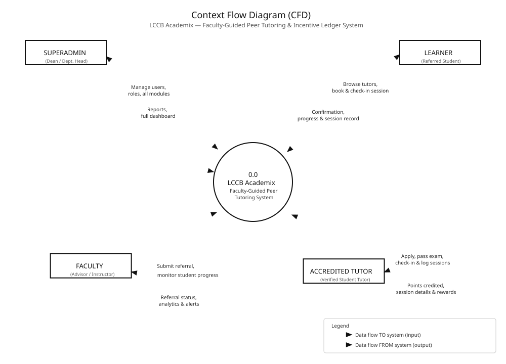
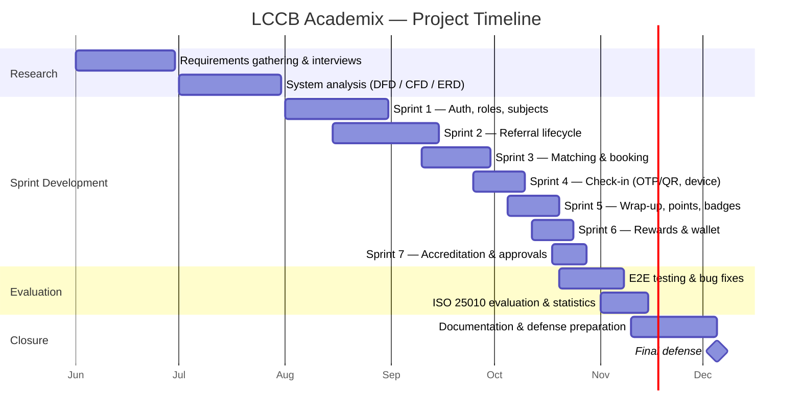

# LCCB ACADEMIX: FACULTY-GUIDED PEER TUTORING AND INCENTIVE LEDGER SYSTEM

## FOR LA CONSOLACION COLLEGE BACOLOD

Submitted In Partial Fulfillment of the Requirements for
**ITS 222: System Analysis and Design**
1st Semester, S.Y. 2026–2027

**Submitted by:**

| | |
|---|---|
| *[Researcher Name]* | *[Researcher Name]* |
| *Project Manager* | *Project Assistant* |
| *[Researcher Name]* | *[Researcher Name]* |
| *Project Documenter* | *Project Developer* |

**Submitted to:**

*[External Advisor]*

Mrs. Bethel B. Tisuela, MSCS
Subject Teacher

**November 2026**

---

# Chapter 1

## Introduction

In every academic institution, the learners who fall behind are rarely the ones who cannot be helped — they are usually the ones who are simply not noticed early enough, or noticed but never given a structured way to recover. Peer tutoring remains one of the most cost-effective and consistently validated responses to this problem: decades of research confirm that when students are tutored by fellow students, the tutee gains measurable academic improvement while the tutor deepens and reinforces his or her own mastery of the subject. For a college such as La Consolacion College Bacolod, peer tutoring is not merely an accommodation service; it is a formal obligation under student-welfare programs, and the service hours completed by student-tutors are meant to be recognized with community-service incentives.

However, despite the maturity of the practice, most tutorial programs in local colleges — including La Consolacion College Bacolod — continue to run through traditional, manual means. Faculty members flag at-risk learners through verbal reminders, paper referral slips, or personal chat messages. Students find tutors through word-of-mouth. Session attendance is "confirmed" by the memory and honesty of the participants themselves. The community-service hours of tutors are tallied on scattered spreadsheets or handwritten certificates, and the points a learner or tutor has supposedly earned cannot be verified, audited, or redeemed against any official catalog. This fragmentation creates what is effectively an invisible program: real hours are rendered and real help is given, but no official institutional record ever proves it.

La Consolacion College Bacolod, an Augustinian institution in Bacolod City, exemplifies this operational reality. The college has accredited student-tutors across its departments — Information Technology, Accountancy, Education, Business Administration — and faculty members who actively refer students for remediation, yet the entire cycle from referral to incentive lives on disconnected forms and informal accounts. The absence of a unified digital platform not only exposes the program to disputes, duplicated claims, and audit failure, but also denies the college the one thing a service program needs to justify its budget and scale: reliable data on who is being helped, by whom, and how effectively.

By implementing LCCB ACADEMIX — a faculty-guided peer tutoring and incentive ledger system — the college will not only resolve its immediate record-keeping bottlenecks but also transform peer tutoring from an unrecorded favor into an official, quotable program. Faculty referrals are tracked to resolution; tutor matching is performed through a verifiable directory of accredited, available tutors per subject; session attendance is double-confirmed through one-time identification tokens or through a fingerprint-capable check-in device; and every completed session closes with a tutor's note, a learner rating, an automatic hour deduction from the referral, and an automatic posting of community points to a permanent, append-only ledger that learners can redeem against an official campus rewards catalog. The college gains a single dashboard of live analytics — active tutors, delivered hours, points issued, referral recovery rate — that turns the tutoring program into a defensible, data-driven institutional service.

---

## Statement of the Problem

The study aims to design and develop a **Faculty-Guided Peer Tutoring and Incentive Ledger System for La Consolacion College Bacolod**.

Specifically, it seeks to answer the following questions:

1. What is the current status of the peer tutoring operations of La Consolacion College Bacolod in terms of:
   1. Referral handling for at-risk learners and tutor matching per subject;
   2. Session scheduling, attendance, and check-in verification;
   3. Service-hour recording, community-points accounting, and reward redemption?
2. What are the challenges encountered by the faculty, learners, accredited tutors, and administrators using the current manual procedures?
3. What is the level of acceptability of the developed system in terms of:
   1. Functional Suitability
   2. Performance Efficiency
   3. Usability
   4. Security

---

## Objectives of the Study

### General Objective

To design, develop, and evaluate a centralized, auditable, Faculty-Guided Peer Tutoring and Incentive Ledger System for La Consolacion College Bacolod that integrates referral tracking, tutor matching, verified session attendance, automatic service-hour and community-points accounting, reward redemption, and tutor accreditation into a single digital platform.

### Specific Objectives

To assess the current status of peer tutoring operations at La Consolacion College Bacolod regarding referral handling, session attendance, and service-hour and reward recording.

To identify manual operational challenges and develop a web-based system featuring a faculty referral board, an accredited tutor matching wizard, a double-confirmed OTP/QR and device-fingerprint check-in, an atomic session wrap-up that posts points and badges, and a superadmin approval board with live analytics — all governed by an append-only points ledger.

To evaluate the level of acceptability of the developed system among learners, tutors, faculty, and administrators based on ISO 25010 quality standards in terms of Functional Suitability, Performance Efficiency, Usability, and Security.

---

## Significance of the Study

The development of the Faculty-Guided Peer Tutoring and Incentive Ledger System is expected to provide significant improvements to the tutoring program of La Consolacion College Bacolod. Specifically, the following groups will benefit from this study:

**Faculty / Academic Advisers**

Teachers no longer have to chase paper referral slips or wonder whether a referred student is actually attending sessions. The referral board gives them a live status for every flagged learner — flagged, assigned, in-progress, resolved — together with the remaining mandatory hours and the tutor's accompanying notes after every wrap-up. Early intervention becomes measurable: a professor can see at a glance which referrals are recovering and which have stalled.

**Students (Learners)**

The system gives learners a transparent path from being "flagged" to being "resolved." Instead of waiting for a faculty member to personally arrange a tutorial, the learner can search an official directory of accredited tutors by subject and availability, book a session, confirm attendance with a one-time code, and watch attendance credits post directly to a personal ledger. The clouds of uncertainty over "did my hours count?" are eliminated.

**Accredited Student-Tutors**

Tutors earn verifiable community service points (+50 per completed session), achievement badges, and a permanent service record that survives beyond the semester. Their accreditation status is official and searchable, and their accumulated points can be redeemed from an official campus rewards catalog with automatically issued vouchers — ending the informal IOU-style recognition that previously depended on incomplete handwritten records.

**College Administration (Superadmin / Dean)**

The administrator gains a single "bird's-eye view" of the entire tutoring program through a dashboard of CTE-powered analytics: active accredited tutors, delivered hours, points issued, referral recovery rates, per-department breakdowns, and six-week trends. Every approval (tutor accreditation, with the dean's certification recorded) and every point issuance sits on an append-only ledger, giving the college a trustworthy audit trail it has never had.

**Future Researchers**

This research provides IT students who want to develop institutional record systems with a complete, reproducible technical reference — a web architecture (React + Express + PostgreSQL) that unites role-based access control, one-time-token attendance verification, atomic ledger transactions, and server-graded examinations. Future researchers examining blockchain-style append-only incentive ledgers or biometric event sourcing can use this study as a baseline.

---

## Scope and Limitations of the Study

This section establishes the specific boundaries of the research by defining the exact features, target users, and deployment environment of the proposed system. It clearly outlines the operational capabilities included in the project, as well as the technical constraints and omitted functionalities necessary to ensure a realistic development timeline.

### Scope

The study focuses on the development and implementation of a web-based peer tutoring and incentive ledger system tailored specifically for the operations of La Consolacion College Bacolod. The system's primary capabilities are bound by the following features:

**Referral Management:** A faculty-and-superadmin module for flagging at-risk learners. Each referral records the learner, subject, urgency, topic, and required number of hours, and is tracked through a strict lifecycle (flagged → assigned → in-progress → resolved) with a provision that the referral auto-resolves when its remaining hours reach zero.

**Tutor Matching and Booking:** A public tutor directory filterable by subject accreditation and availability, and a learner matching wizard that produces session requests carrying topic, preferred date, time, and room. Only tutors accredited for the requested subject may accept, and double-accept is prevented at the server level.

**Session Check-In:** A two-party attendance verification module. The tutor stages a one-time identification token (OTP/QR code pair) with a ten-minute validity; both participants must confirm the same token before the session officially starts. A secondary physical channel allows a fingerprint-capable device to import a session roster and verify participants through a secured device key.

**Session Wrap-Up (Incentive Ledger Core):** A single atomic transaction that closes the session by recording the tutor's notes and the learner's 1–5 rating, debiting the hours from the referral, crediting the points ledger (+50 to the tutor, +25 to the learner), and awarding achievement badges.

**Rewards Catalog and Redemption:** An official campus catalog of rewards priced in community points, with server-side stock control (row-locked decrements), a ledger debit, and an automatically generated voucher on successful redemption.

**Tutor Accreditation:** A learner-initiated application (subjects + supporting documents of academic achievement), a one-shot qualification examination graded by the server (correct answers are never exposed to the client), and a superadmin approval board that formally sets the tutor's verified status and certifying officer.

**Institutional Analytics and Public View:** A superadmin dashboard of aggregated KPIs, six-week trends, and department-level statistics; and an anonymous public landing page showing live totals (verified tutors, hours delivered, points issued) as an official community ledger.

### Limitations of the Study

To ensure the project remains focused and achievable, the proposed system is subject to the following limitations:

**Notification Delivery:** Notifications are delivered in-app only. The system does not integrate SMS or e-mail gateways, so urgent alerts (a referral flag, a check-in window opening) still rely on the college's existing informal channels to reach students quickly.

**Payment Processing:** The system calculates point debits and issues vouchers, but the physical release of rewards is handled manually by the campus office. It does not process e-wallet (GCash/Maya) or cash transactions directly through the software.

**Real-Time Biometric Sync:** The system does not pull fingerprint logs live from the physical device over the cloud. The device posts imported rosters and verification records through its own secured HTTPS client (batch processing), keeping the web application independent of any specific hardware vendor.

**Native Mobile Application:** The system is a progressive web-style application accessed through a standard browser. Learners and tutors cannot install a native Android/iOS package, and offline check-in requires an active network connection to the school's server.

**Academic Records Integration:** The system's analytics are limited to the data it captures. It does not import grades from the registrar or connect to the Learning Management System; referral urgency and progress are judged by faculty, not automatically predicted.

---

## Definition of Terms

For the purpose of clarity and better understanding of this study, the following terms are defined conceptually and operationally:

**Accreditation**

*Conceptual:* The formal process by which an institution certifies that an individual possesses the competence to perform a specific service or role.

*Operational:* The workflow in the system where a learner submits an application with supporting documents, passes a one-shot server-graded qualification exam, and shortly receives the superadmin's (dean's) approval, which flags his or her account as an official verified tutor.

**Attendance Credit**

*Conceptual:* An official recognition of a person's verified presence at a scheduled activity.

*Operational:* The +25 community points automatically posted to a learner's ledger when a checked-in session is wrapped up.

**Badge**

*Conceptual:* A visual emblem awarded to recognize the completion of a notable accomplishment.

*Operational:* The achievement markers (e.g., "First Session") the system automatically grants after a completed wrap-up transaction.

**Check-In**

*Conceptual:* The act of registering one's presence at a scheduled event or session.

*Operational:* The two-party verification step in the system where both tutor and learner confirm the same one-time token (or where a device verifies participants by fingerprint) before a session is allowed to start.

**Community Points**

*Conceptual:* A unit-based incentive currency earned through verified service or participation and redeemable for benefits.

*Operational:* The ledger entries (+50 to tutors, +25 to learners) issued only upon completion of a double-confirmed session, recorded permanently and redeemable from the rewards catalog.

**JWT (JSON Web Token)**

*Conceptual:* An open-standard, digitally signed token used to securely verify a user's identity between software systems.

*Operational:* The signed token issued upon login that every subsequent request from the learner, tutor, faculty, or superadmin presents to prove their session.

**Ledger (Points Ledger)**

*Conceptual:* A permanent, append-only record of every value-generating or value-consuming transaction in a system.

*Operational:* The system's single authoritative table of every point issuance and debit — credits for wrap-ups, debits for redemptions — which serves as the official audit trail of the college's tutoring incentives.

**Learner / Tutee**

*Conceptual:* A student who has been identified as needing remediation in a specific subject area.

*Operational:* The user role that receives faculty referrals, searches accredited tutors, books sessions, confirms check-ins, and earns attendance credits toward reward redemption.

**OTP (One-Time Password) Token**

*Conceptual:* A temporary, single-use password used to verify identity for a single event within a limited time window.

*Operational:* The six-digit code pair (e.g., "836701-793354") staged by the tutor with a ten-minute validity, which both participants must confirm once each before the session starts; reuse is rejected.

**Referral**

*Conceptual:* A formal recommendation directing a person toward a specific support service.

*Operational:* The faculty-initiated record carrying a learner, subject, urgency, topic, and required hours, tracked through the statuses flagged, assigned, in-progress, and resolved.

**Rewards Catalog**

*Conceptual:* An official list of items or privileges available to participants in exchange for their accumulated reward currency.

*Operational:* The college's official list of campus perks (library passes, photocopy vouchers, printing credits) priced in community points, with server-enforced stock levels and voucher issuance per successful redemption.

**Session**

*Conceptual:* A scheduled, bounded meeting between a service provider and a recipient for a specific purpose.

*Operational:* The booked tutoring hour between an accredited tutor and a learner, carrying a topic, subject, date, time, room, numeric duration, and a status progresses from upcoming through in-progress to completed.

**Superadmin**

*Conceptual:* The highest-level administrator of a system, with unrestricted access to all modules and data.

*Operational:* The dean-level role that manages tutor accreditation approvals, rewards stock, referral oversight, and all institutional analytics for the college.

**Voucher**

*Conceptual:* A printed document that entitles its holder to claim a specific good or privilege.

*Operational:* The automatically generated claim code (e.g., "LCCB-A6CC65C0") issued to a learner's account upon a successful points redemption.

**Wrap-Up**

*Conceptual:* The formal closing stage of an activity in which results are evaluated and recorded.

*Operational:* The single atomic transaction in the system that ends a session, saves the tutor's notes and the learner's 1–5 rating, debits hours from the referral, auto-resolves exhausted referrals, and posts points and badges to the ledger.

---

# Chapter 2

## Review of Related Literature and Studies

This chapter presents a concise review of academic literature and existing systems that establish the foundation for the Faculty-Guided Peer Tutoring and Incentive Ledger System for La Consolacion College Bacolod. The gathered materials highlight gaps in mentoring program record-keeping and the necessity of verified attendance and incentive accounting in educational service programs.

### Review of Related Literature

This section evaluates key concepts and evidence regarding peer tutoring as an academic intervention and the incentive/recognition structures that sustain it.

**Foreign Related Literature**

*Peer Tutoring Effectiveness and Reward Structure.* Meta-analytic evidence across decades confirms that peer-assisted learning reliably raises achievement for tutees and tutors alike, with the largest gains accruing to the youngest, lowest-performing, and highest-need students. Crucially, these analyses also demonstrate that the effect of a tutoring program is amplified when reward contingencies are interdependent — that is, when both parties visibly benefit, the evaluation is ipsative (self-referenced progress against one's own baseline) and the participant retains autonomy (Rohrbeck, Ginsburg-Block, Fantuzzo & Miller, 2003). This directly explains why an institution cannot simply "encourage" struggling students to find help: the program must be structured so that progress is visible, benefits flow automatically, and matching remains learner-initiated where possible.

*Gamified Incentives in Digital Learning Environments.* Gamification research in university settings shows that points, badges, and leaderboards can produce meaningful improvements in effort and engagement, but only when the game elements are anchored to verifiable learning activity rather than participation theater — superficial points awarded for mere presence produce no benefit and can even crowd out intrinsic motivation (Domínguez, de Navarrete, de Marcos, Fernández-Sanz, Pagés & Martínez-Herráiz, 2013). This finding establishes the design rule adopted by the present system: points are never issued for accounts or activity; they post only after a double-verified session has closed, and badges serve as legible milestones on an audited service record.

**Local Related Literature**

*Peer Tutoring in the Philippine Setting.* Local quasi-experimental evidence strongly parallels the foreign findings. At a Philippine university, struggling Grade 8 science students who accepted peer tutoring showed better participation, stronger expert-like perceptions of science, and higher exam performance than similarly struggling peers who did not attend sessions (Bellen & Jomoc, 2017). In another study, Grade 5 pupils in Sanchez Mira, Cagayan experienced significant, large-effect improvement in mathematics after structured peer tutoring — leading the author to stress that a tutoring program's effect depends critically on how well its structure is engineered (Danga, 2022). Both works share a common undertone for the present study: in the Philippine context, the tutoring itself works, but it is the *record-keeping around it* that usually collapses — referrals circulate informally, sessions are attended without verification, and service hours are stacked on paper.

**Synthesis of Related Foreign and Local Literature**

The reviewed literature establishes that structured peer tutoring is a validated high-impact intervention and that its effectiveness is magnified by automatic reward contingencies and learner autonomy. Both global meta-analytic evidence and local Philippine experimental studies converge on the same principle: the tutoring works, but only when its structure — matching, verification, and recognition — is engineered deliberately rather than administered by memory. This justifies the present system's design of an institution-backed directory, an automatic double-confirmation check-in, and an append-only incentive ledger.

### Review of Related Studies

This section presents existing research on implemented systems for tutoring program administration, verified attendance systems, and incentive ledgers.

**Foreign Related Studies**

*Peer Tutoring Program Administration in Higher Education.* A recent comprehensive meta-analysis focused specifically on peer tutoring in higher education confirmed significant positive effects on tutees' academic performance and, importantly for system builders, isolated the conditions under which programs succeed: structured sessions, explicit role expectations, and clear reporting (Zhang, Sun, Jiang et al., 2025). These moderators map directly to software features: a session cannot exist without both parties' roles being fixed at creation, and cannot be "counted" without a completed wrap-up record.

*Verified Digital Attendance Systems.* QR code-based attendance implementations have demonstrated that short-lived, digitally verified codes substantially reduce manual record errors and eliminate proxy attendance compared with pen-and-paper logs (Amin, Lusiana, Hartono & Wahyu, 2024). At the same time, these studies identify the key security risk of digital check-in — token replay and reuse — which the present system neutralizes by issuing strictly one-shot identification tokens with a ten-minute validity and rejecting any reuse with an immediate server-side rejection.

**Local Related Studies**

*Peer Tutorial Programs and Student Recognition.* A study of a university-based peer tutorial program in the Philippines documented through thematic analysis the programs' benefits to students who were at risk of failing: good study habits, improved academic performance, reinforced subject mastery, and confidence — but also emphasized that participation and recognition must be made *visible and institutionally backed* for these benefits to be sustained (Tan, 2020). This validates the present system's insistence that recognition be mechanical rather than occasional: each completed wrap-up posts credits and badges regardless of whether anyone remembers to do so manually.

*Web-Based Biometric and QR Attendance Systems in Philippine Institutions.* A system developed for a state university in Sorsogon demonstrated that QR-based recording dramatically reduced manual verification time and produced defensible, timestamped attendance records in an institutional setting (Agripa & Astillero, 2022). This supports the present system's dual-channel design: a fully digital check-in (OTP/QR confirmations) for online or device-capable sessions, and a device-fingerprint channel (`/device/import-roster`, `/device/verify` secured by a device key) for physically held laboratory sessions where participants lack reliable personal devices.

**Synthesis of Related Foreign and Local Studies**

Existing studies consistently demonstrate that structured, verified, and recognized tutoring programs outperform informal ones, and that digital verification of attendance is the single most defensible way to anchor claims about service rendered. While foreign and local research frequently addresses each component in isolation — either tutoring outcomes or attendance devices or gamified incentives — a gap remains for a unified platform tailored to the complete cycle of a college peer tutoring program: referral → matching → verified attendance → wrap-up → automatic points → redemption → accreditation, all under one append-only ledger. This is the specific gap that the LCCB ACADEMIX system fills.

---

# Chapter 3

## Methodology

The system was developed through iterative sprints (an Agile-style workflow) so that each module — referral, matching, check-in, wrap-up, rewards, accreditation — was demonstrated to stakeholders before the next was built. The methodology chapter presents the system analysis through its Context Flow Diagram (CFD) and Data Flow Diagram (DFD Level 0), the project timeline through a Gantt chart, and the project's financial viability through its development cost, operating cost, and cost–benefit analysis.

## Context Free Diagram (CFD)

The Context Flow Diagram presented below illustrates the highest-level overview of the Faculty-Guided Peer Tutoring and Incentive Ledger System developed for La Consolacion College Bacolod. It depicts the system as a single central process — represented by a cylinder labeled "LCCB ACADEMIX" — surrounded by all external entities that interact with it. The CFD does not show internal processes or data stores; instead, it focuses on identifying the key actors in the system and the nature of the data that flows between them and the system as a whole. Six external entities are identified in the diagram.

The **Superadmin**, who represents the dean or department head, has full access to manage users, roles, tutor accreditation approvals, and rewards stock, and in return receives the full institutional dashboard, analytics, and the append-only ledger record. The **Faculty / Academic Adviser** submits referrals for at-risk learners and assigns or monitors them, and in return receives live referral statuses, remaining mandatory hours, and wrap-up notes. The **Accredited Student-Tutor** applies for accreditation, answers the qualification exam, accepts session requests, stages check-in tokens, and submits wrap-up notes and ratings, and in return receives session details, community-point credits, badges, and a permanent service record. The **Learner (Tutee)** searches accredited tutors, books sessions, confirms check-ins, and redeems points, and in return receives booking confirmations, session records, attendance credits, and redemption vouchers. The **Biometric / Check-In Device** sends imported session rosters and fingerprint verification events to the system and receives roster validity results in exchange. Finally, the **General Public (Visitor)** sends no credentials at all: the anonymous landing page hands the community's live ledger totals — verified tutors, delivered hours, points issued — to anyone who signs in or browses.



**Figure 1. Context Flow Diagram (CFD) of the LCCB Academix Peer Tutoring and Incentive Ledger System**

## Data Flow Diagram (Level 0 DFD)

The Data Flow Diagram at Level 0 presented below provides a more detailed representation of the internal processes of the LCCB Academix system. Unlike the CFD, the DFD decomposes the system into its six major processes and shows how data flows between external entities, processes, and data stores. Each process is numbered and labeled to clearly indicate its function, and the data stores are represented using the standard open-ended rectangle notation, identified as DS1 through DS6.

**Process 1 (P1), Login and Authentication,** handles the verification of user credentials against the users data store (DS1) and issues a signed session token (JWT) with the user's role upon successful validation. All four human entities — Superadmin, Faculty, Accredited Tutor, and Learner — interact with this process. **Process 2 (P2), Referral Management,** is operated by the Faculty and Superadmin entities and records referrals into the referrals data store (DS2), tracks their lifecycle status (flagged → assigned → in-progress → resolved), and feeds referral positions to the analytics process. **Process 3 (P3), Matching and Session Request,** is the core dispatch process: the Learner sends a search (subject accreditation and availability), the process matches it against accreditation data within DS1, and a tutor's acceptance writes the resulting session to the sessions data store (DS3), with double-accept prevented at the server level.

**Process 4 (P4), Check-In and Verification,** receives the one-time token staged by the Tutor, the confirmations from both the Learner and the Tutor (each token usable once within a ten-minute window), and roster/fingerprint verifications passed from the Biometric Device; it writes confirmed attendance rows into DS3 and starts the session when both confirmations are present. **Process 5 (P5), Wrap-Up and Incentive Ledger,** receives the notes and 1–5 rating submitted at the session's end, debits the hours from the referral record in DS2 (auto-resolving referrals at zero hours remaining), and posts the tutor's and learner's credits, badges, and the wrap-up audit trail into the points ledger data store (DS4). **Process 6 (P6), Rewards Redemption,** receives the learner's redemption request, applies row-locked stock decrements and ledger debits against the rewards data store (DS5), and issues a voucher back to the Learner at the point of purchase; accreditation applications and the one-shot, server-graded examination answers are also held and graded against the applications data store (DS6), with the Superadmin's approval (or rejection) writing the dean's certification back into DS1. Together, these six processes represent the complete operational scope of the LCCB Academix Peer Tutoring and Incentive Ledger System.

```mermaid
flowchart TB
    FAC([Faculty / Adviser]) & LEA([Learner / Tutee]) & TUT([Accredited Student-Tutor]) & ADM([Superadmin]) & DEV([Biometric / Check-In Device]) & PUB([General Public / Visitor])

    P1["P1 — Login & Authentication"]
    P2["P2 — Referral Management"]
    P3["P3 — Matching & Session Request"]
    P4["P4 — Check-In & Verification"]
    P5["P5 — Wrap-Up & Incentive Ledger"]
    P6["P6 — Rewards & Accreditation Services"]

    D1[("DS1 — Users")]
    D2[("DS2 — Referrals")]
    D3[("DS3 — Sessions & Check-Ins")]
    D4[("DS4 — Points Ledger")]
    D5[("DS5 — Rewards")]
    D6[("DS6 — Applications (Exams)")]
    D7[("DS7 — Subjects & Accreditations")]

    FAC -- credentials --> P1
    LEA -- credentials --> P1
    TUT -- credentials --> P1
    ADM -- credentials --> P1
    P1 <--> D1
    P1 -- signed JWT + role --> FAC & LEA & TUT & ADM

    FAC -- referral details --> P2
    ADM -- assign / oversee --> P2
    P2 <--> D2
    P2 -- status & remaining hours --> FAC

    LEA -- subject & availability filters --> P3
    TUT -- accept / decline request --> P3
    P3 <--o accreditation match -->o D7
    P3 -- session record --> D3

    TUT -- staged OTP/QR token --> P4
    LEA -- check-in confirmation --> P4
    DEV -- roster + fingerprint events --> P4
    P4 -- attendance rows & session start --> D3

    TUT -- notes + rating --> P5
    LEA -- confirmation of wrap-up --> P5
    P5 -- hour debit --> D2
    P5 -- +50 / +25 credits, badges, audit trail --> D4

    LEA -- redeem / apply --> P6
    P6 <--o stock & vouchers -->o D5
    P6 <--o exam answers & grades -->o D6
    ADM -- approve / reject accreditation --> P6
    PUB -- anonymous request --> P6
    P6 -- live totals & vouchers --> PUB
    P6 -- serve analytics KPIs --> ADM
```

**Figure 2. Data Flow Diagram — Level 0 (DFD) of the LCCB Academix Peer Tutoring and Incentive Ledger System**

## Project Gantt Chart

The Gantt chart below presents the project's actual timeline: requirements gathering and system analysis during the early summer, followed by eight development sprints (reflection of the system's modular build — authentication, referral lifecycle, matching, check-in channels, wrap-up/ledger transaction, rewards and wallet, accreditation, and analytics), a dedicated testing and evaluation phase, and documentation closure for the final defense.



**Figure 3. Gantt Chart of the LCCB Academix Peer Tutoring and Incentive Ledger System**

## Development Cost

The total development cost amounts to **₱2,900.00**, covering only the fixed and unavoidable expenses of domain registration (₱800.00), web hosting (₱1,500.00), and physical printing and binding of the research paper (₱600.00). All development labor, system design, database modelling, core coding, testing, and documentation were performed by the researchers at no charge, as this system was built in-house as part of an academic thesis requirement. The application runs on free-tier cloud services, and the embedded PostgreSQL database runs locally for demonstrations, so no software licences were purchased.

**Figure 4. Development Cost of the LCCB Academix Peer Tutoring and Incentive Ledger System**

| Item | Particulars | Cost (₱) |
|---|---|---:|
| 1 | Domain registration (1 year) | 800.00 |
| 2 | Web hosting / cloud deployment | 1,500.00 |
| 3 | Printing & binding of research papers | 600.00 |
| | **Total Development Cost** | **₱2,900.00** |

## Operating Cost

The projected annual operating cost is **₱2,800.00**, which accounts for future system upkeep and a maintenance safety margin. This includes a ₱500.00 contingency buffer allocated for unexpected operational issues, minor local repairs, or physical supplies (rewards voucher paper, evaluation forms). The remaining ₱2,300.00 covers the deferred annual renewal expenses for domain registration (₱800.00) and shared web hosting (₱1,500.00). These web fees are currently non-incurred and will only apply if the management decides to migrate the software permanently online, as the platform is currently fully operational using free-tier hosting (Vercel Hobby tier and a free managed PostgreSQL instance). All other recurring operational needs — including system maintenance, database backups, rewards stock updates, exam-question refreshes, and continuous staff training — are managed directly by the researchers at zero cost, as they have been formally designated to oversee the system administration upon deployment.

**Figure 5. Operating Cost of the LCCB Academix Peer Tutoring and Incentive Ledger System**

| Item | Particulars | Annual Cost (₱) |
|---|---|---:|
| 1 | Contingency buffer (repairs, supplies, voucher forms) | 500.00 |
| 2 | Deferred domain renewal | 800.00 |
| 3 | Deferred shared web hosting | 1,500.00 |
| 4 | System maintenance, backups, staff training (researchers) | 0.00 |
| | **Total Annual Operating Cost** | **₱2,800.00** |

## Cost-Benefit Analysis

The cost–benefit analysis compares the system's total cash outlay against the tangible annual savings it generates for the college once manual record-keeping is retired.

**Tangible Annual Benefits.** The system eliminates four major recurring expenses of the manual process. First, the manual encoding of referrals, service-hour certificates, and redemptions by staff or faculty consumes approximately four (4) hours per week, valued at ₱250.00 per hour, for an annual saving of **₱40,000.00**. Second, the printed forms, certificates, and approval sheets previously used for referrals and tutorial logs average around 400 pages per term, or **₱8,000.00** per year in paper, ink, and printing. Third, verified digital check-in and the append-only ledger eliminate disputed and duplicated service-hour claims that typically consume 20 staff hours per year to reconcile, valued at **₱5,000.00**. Fourth, the automated rewards stock control removes the manual catalogue reconciliation previously handled during redemption periods, worth roughly **₱3,000.00** per year. The total tangible annual benefit is therefore **₱56,000.00**, exclusive of the intangible benefits — auditability, faster dean's decisions, student motivation through visible recognition, and data-driven deployment of tutors to the subjects of greatest need.

**Figure 6. Cost–Benefit Analysis Summary (5-Year Horizon, in Philippine Pesos)**

| Year | Recurring Cash Cost (₱) | Total Cost Prev. Cum. (₱)* | Benefit (₱) | Net Cumulative (₱) |
|---|---:|---:|---:|---:|
| 0 (build) | 2,900.00 (one-time) | 2,900.00 | 0 | −2,900.00 |
| 1 | 2,800.00 | 5,700.00 | 56,000.00 | **+50,300.00** |
| 2 | 2,800.00 | 8,500.00 | 56,000.00 | +102,800.00 |
| 3 | 2,800.00 | 11,300.00 | 56,000.00 | +155,300.00 |
| 4 | 2,800.00 | 14,100.00 | 56,000.00 | +207,800.00 |
| 5 | 2,800.00 | 16,900.00 | 56,000.00 | **+263,100.00** |

\* *Cumulative total cost = development cost + cumulative operating cost.*

**Payback period:** the ₱5,700 first-year total cash outlay is fully recovered by the ₱56,000.00 annual tangible savings within approximately the first two (2) months of operation, after which the system yields a net annual benefit of roughly ₱53,000.00 to the college.

**Return on Investment (5-year):** (₱263,100.00 ÷ ₱16,900.00) × 100 ≈ **1,556%**, with the figure driven primarily by the fact that development labor was donated by the researchers. Even excluding the labor exemption, the system remains decisively positive because its recurring cost is negligible against the administrative labor it displaces.

---

## Webliographies

Agripa, D. J. B., & Astillero, S. (2022). *Development of employee attendance and management system using Quick Response (QR) code in Sorsogon State University, Castilla Campus, Philippines.* European Journal of Education Studies, 9(11). Retrieved from https://doi.org/10.46827/ejes.v9i11.4545

Amin, I., Lusiana, V., Hartono, B., & Wahyu, D. (2024). *QR code-based attendance system for contact tracking post-pandemic.* CogITo Smart Journal, 10(1), 436–450. Retrieved from https://doi.org/10.31154/cogito.v10i1.490.436-450

Bellen, J. A., & Jomoc, A. B. (2017). *Supporting struggling Grade 8 science students' motivation, participation and performance through peer-tutoring approach.* Annals of Tropical Research, 39(1). Retrieved from https://ejournals.ph/article.php?id=26895

Danga, M. O. (2022). *Peer tutoring: Its effects on academic performance of 5th grade students in mathematics at Sanchez Mira Central Elementary School.* AIDE Interdisciplinary Research Journal, 2(1). Retrieved from https://ejournals.ph/article.php?id=18148

Domínguez, A., de Navarrete, J., de Marcos, L., Fernández-Sanz, L., Pagés, C., & Martínez-Herráiz, J. (2013). *Gamifying learning experiences: Practical implications and outcomes.* Computers & Education, 63, 380–392. Retrieved from https://doi.org/10.1016/j.compedu.2013.01.004

International Organization for Standardization. (2011). *ISO/IEC 25010: Systems and software engineering — Systems and software quality requirements and evaluation (SQuaRE).* Retrieved from https://www.iso.org/standard/35733.html

Internet Engineering Task Force. (2015). *RFC 7519: JSON Web Token (JWT).* Retrieved from https://datatracker.ietf.org/doc/html/rfc7519

Rohrbeck, C. A., Ginsburg-Block, M. D., Fantuzzo, J. W., & Miller, T. R. (2003). *Peer-assisted learning interventions with elementary school students: A meta-analytic review.* Journal of Educational Psychology, 95(2), 240–257. Retrieved from https://doi.org/10.1037/0022-0663.95.2.240

Tan. (2020). *Peer tutorial: Championing students at risk.* International Journal of Learning, Teaching and Educational Research, 19(6). Retrieved from http://www.ijlter.org/index.php/ijlter/article/view/2203

Zhang, C., Sun, N., Jiang, Y., et al. (2025). *The impact of peer tutoring programs on students' academic performance in higher education: A meta-analysis.* The Asia-Pacific Education Researcher, 34, 1495–1506. Retrieved from https://doi.org/10.1007/s40299-024-00960-0
