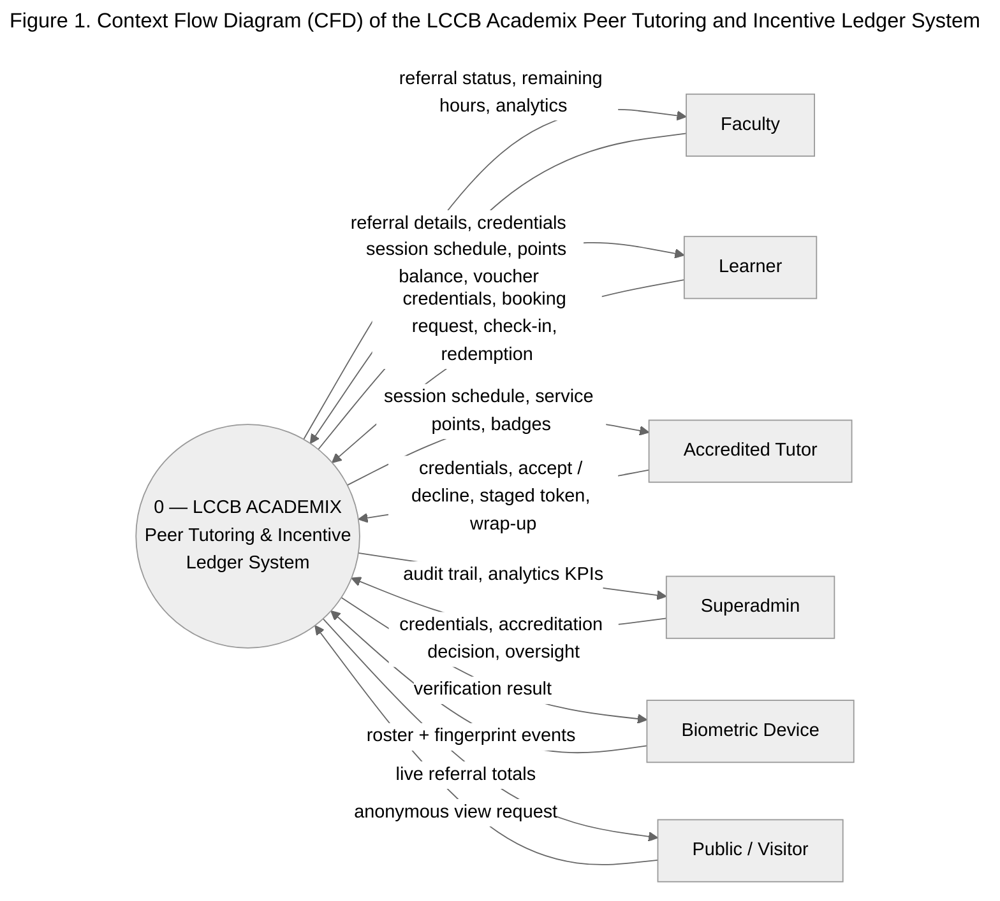

# CFD & DFD — Yourdon Notation (Mermaid Source)

Yourdon/DeMarco notation used throughout:

| Symbol | Meaning | Mermaid shape |
|---|---|---|
| Rectangle | External entity (source/sink) | `["..."]` |
| Circle (bubble) | Process | `(("..."))` |
| Two parallel lines | Data store | `@{ shape: datastore }` |
| Labeled arrow | Data flow | `-->|"label"|` |

> Requires Mermaid ≥ 11.3 for the `datastore` shape (GitHub, VS Code, and mermaid.live are current enough). The `theme: neutral` front-matter keeps the diagrams grayscale-safe for printed documentation.

---

## Figure 1 — Context Flow Diagram (CFD)

---

## Figure 2 — Data Flow Diagram, Level 0 (DFD)

```mermaid
---
title: Figure 2. Data Flow Diagram — Level 0 (DFD) of the LCCB Academix Peer Tutoring and Incentive Ledger System
config:
  theme: neutral
---
flowchart TB
    %% ── External entities (rectangles) ─────────────────────────────
    FAC["Faculty"]
    LEA["Learner"]
    TUT["Accredited Tutor"]
    ADM["Superadmin"]
    DEV["Biometric Device"]
    PUB["Public / Visitor"]

    %% ── Processes (Yourdon circles) ────────────────────────────────
    P1(("P1<br/>Login &<br/>Authentication"))
    P2(("P2<br/>Referral<br/>Management"))
    P3(("P3<br/>Matching &<br/>Session Request"))
    P4(("P4<br/>Check-In &<br/>Verification"))
    P5(("P5<br/>Wrap-Up &<br/>Incentive Ledger"))
    P6(("P6<br/>Rewards &<br/>Accreditation"))

    %% ── Data stores (Yourdon open rectangles) ─────────────────────
    D1@{ shape: datastore, label: "DS1 · Users" }
    D2@{ shape: datastore, label: "DS2 · Referrals" }
    D3@{ shape: datastore, label: "DS3 · Sessions & Check-Ins" }
    D4@{ shape: datastore, label: "DS4 · Points Ledger" }
    D5@{ shape: datastore, label: "DS5 · Rewards" }
    D6@{ shape: datastore, label: "DS6 · Applications & Exams" }
    D7@{ shape: datastore, label: "DS7 · Subjects & Accreditations" }

    %% ── P1 — Login & Authentication ────────────────────────────────
    FAC & LEA & TUT & ADM -->|"credentials"| P1
    P1 -->|"signed JWT + role"| FAC & LEA & TUT & ADM
    P1 -->|"verify account"| D1
    D1 -->|"user record + role"| P1

    %% ── P2 — Referral Management ───────────────────────────────────
    FAC -->|"referral details"| P2
    ADM -->|"assign / oversee"| P2
    P2 -->|"write / update status"| D2
    D2 -->|"referral record, hours"| P2
    P2 -->|"status & remaining hours"| FAC

    %% ── P3 — Matching & Session Request ────────────────────────────
    LEA -->|"subject & availability filters"| P3
    TUT -->|"accept / decline request"| P3
    P3 -->|"read accreditations for match"| D7
    D7 -->|"accredited tutors per subject"| P3
    P3 -->|"session record"| D3

    %% ── P4 — Check-In & Verification ───────────────────────────────
    TUT -->|"staged OTP / QR token"| P4
    LEA -->|"check-in confirmation"| P4
    DEV -->|"roster + fingerprint events"| P4
    P4 -->|"read scheduled session"| D3
    P4 -->|"attendance rows & session start"| D3

    %% ── P5 — Wrap-Up & Incentive Ledger ────────────────────────────
    TUT -->|"notes + rating"| P5
    LEA -->|"wrap-up confirmation"| P5
    P5 -->|"hours debit (auto-resolve)"| D2
    P5 -->|"+50 / +25 credits, badges, audit trail"| D4

    %% ── P6 — Rewards & Accreditation ───────────────────────────────
    LEA -->|"redeem / apply"| P6
    P6 -->|"stock decrement, ledger debit"| D5
    D5 -->|"stock & voucher"| P6
    P6 -->|"exam answers & grades"| D6
    D6 -->|"application & exam record"| P6
    ADM -->|"approve / reject accreditation"| P6
    PUB -->|"anonymous request"| P6
    P6 -->|"live totals & vouchers"| PUB
    P6 -->|"serve analytics KPIs"| ADM
```

---

## Rendering notes

- **GitHub / VS Code / mermaid.live** render these directly (Mermaid ≥ 11.3).
- **For the Word/PDF thesis:** convert to an image with mermaid-cli:
  `npx -y @mermaid-js/mermaid-cli -i figure.mmd -o figure.png -b white -s 3`
  (save each `mermaid` block to its own `.mmd` file first, without the surrounding fences).
- **Prose alignment:** if the chapter keeps the Yourdon figures, update the CFD paragraph from "represented by a cylinder" to "represented by a circle (Yourdon process bubble)".
